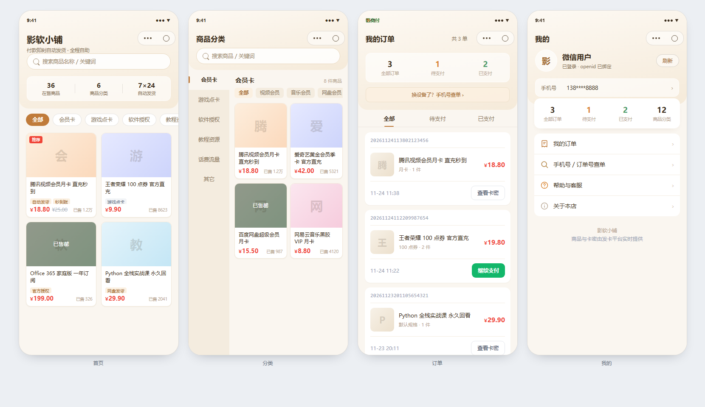

# 影软小铺 · 微信小程序（自动发卡）

第一版：无商户ID导致无法支付下单


暂时还没有后台管理页面，由于无法实现支付，放弃后续的开发了，半成品。转开源的发卡平台了。

第二版：后台对接异次元发卡网

把 `acg-faka` 虚拟商品自动发卡平台包装成微信小程序：用户静默登录 → 浏览分类/商品 → 自助下单 → 扫码或虚拟支付 → 自动发货取卡密 → 查单 → 联系客服。

本版本的核心约束：**不使用云函数、不使用云数据库**。分类、商品、库存、价格、下单、支付、订单状态、卡密，全部实时来自自动发卡平台的 `/user/api/*` 接口。

---

## 一、架构

```
┌──────────────────────────┐        ┌────────────────────────────────────┐
│  微信小程序（纯前端）      │        │  acg-faka 3.8.6（PHP）              │
│                          │        │                                    │
│  services/request.js  ───┼───────►│  /user/api/index/data     分类树     │
│  （统一 Cookie/序列化）   │        │  /user/api/index/commodity 商品列表  │
│  services/api.js      ───┼───────►│  /user/api/index/commodityDetail    │
│  services/auth.js     ───┼───────►│  /user/api/index/stock     实时库存  │
│  services/pay.js      ───┼───────►│  /user/api/index/valuation 实时估价  │
│  services/orders.js   ───┼───────►│  /user/api/order/trade     下单      │
│  services/qrcode.js      │        │  /user/api/order/state     订单状态  │
│  （本地二维码编码器）      │        │  /user/api/index/query     查单      │
│                          │        │  /user/api/index/secret    取卡密    │
│  本地 storage：           │        │                                    │
│   · faka.cookie 会话      │        │  ┌──────────────────────────────┐  │
│   · 订单号快照            │        │  │ Wx.php（配套补丁，新增 4 接口）│  │
│   · 手机号（选填）        │        │  │ /wx/login  /wx/bindPhone     │  │
└──────────────────────────┘        │  │ /wx/vpaySign /wx/logout      │  │
                                    │  └──────────────────────────────┘  │
                                    └────────────────────────────────────┘
```

关键设计取舍：

| 决策 | 原因 |
| --- | --- |
| 商品/分类全部走 faka 接口，本地不落库 | 后台改价、上下架、库存变化立即生效，无需同步 |
| 订单主数据不落库，本地只存订单号 | 无云数据库；卡密不落本地，详情页每次实时取 |
| 收银台链接渲染成本地二维码 | 小程序不能直接打开第三方收银台域名；长按识别在微信内即可付款 |
| 登录放在服务端 `Wx::login` | `code` 换 `openid` 需要 AppSecret，绝不能下发到小程序 |
| 手机号选填 | 不阻断下单；填写后可用于换设备查单 |

---

## 二、目录结构

```
wx-auto-deliver/
├── README.md                    本文件
├── _private/                    本地密钥（勿提交、勿放入 miniprogram/）
├── design/
│   ├── index.html                  ★ 设计稿总览：iframe 内嵌下面全部稿子，配色可切换
│   ├── ui-design-v1.html           11 页高保真稿 + 跳转关系图 + 接口映射
│   ├── light-theme-preview.html    浅色主题 6 套方案对比（可点选，第二轮选型）
│   ├── theme-c-sand.html / .png    方案 C 暖砂米落地效果（真实 wxss 渲染）
│   ├── tabs-fullbleed.html / .png  四个 Tab 页全铺满效果（第三轮）
│   └── build-fullbleed-preview.js  生成 tabs-fullbleed.html 的脚本（可重跑）
├── miniprogram/                 小程序工程根目录（开发者工具打开这一层）
│   ├── app.js / app.json / app.wxss
│   ├── config.js                ★ 部署前唯一必改文件
│   ├── custom-tab-bar/          自定义底部导航（首页/分类/订单/我的）
│   ├── pages/                   11 个业务页面
│   ├── services/                request / api / auth / orders / pay / qrcode
│   ├── utils/format.js          金额、时间、富文本清洗
│   ├── utils/nav.js             自定义导航尺寸（状态栏 / 标题行 / 胶囊让位）
│   ├── project.config.json
│   └── project.private.config.json
└── tests/
    ├── run.js                   全链路测试（60 项）
    ├── static-check.js          静态完整性检查（312 项）
    ├── pay-flow.js              支付页状态机自检（倒计时 → 超时 → 继续支付）
    ├── live-probe.js            真实网络逐接口探测
    ├── mock-faka.js             本地模拟 faka API
    ├── wx-mock.js               本地模拟 wx API
    └── qr-reader.js             独立二维码读取器（交叉验证用）
```

服务端补丁位于 `acgfaka/app/Controller/User/Api/Wx.php`，只新增文件，不修改任何原有代码。

---

## 三、快速开始

### 1. 部署服务端补丁

把 `acgfaka/app/Controller/User/Api/Wx.php` 复制到线上站点同路径：

```
站点根目录/app/Controller/User/Api/Wx.php
```

路由按 faka 的 `Controller/User/Api/*` 约定自动生效，无需改配置。补丁内置自检接口，**部署完先访问它**：

```bash
curl http://resfox.dpdns.org/user/api/wx/ping
```

| 返回 | 含义 | 处理 |
| --- | --- | --- |
| `{"code":200,...,"patch":"wx-mini-1.1.0"}` | 补丁已生效 | 再看 `appid` / `secret` 是否已配置 |
| HTTP 404（faka 的「页面没有找到」） | 文件没落到正确路径 | 核对是否为 `app/Controller/User/Api/Wx.php` |
| HTTP 500 / 空响应 | 文件在，但 PHP 报错 | 打开站点 DEBUG 或查 PHP 错误日志 |

`ping` 不写库、不需要 `code`，也不回显密钥（`appid` 脱敏，`secret` 只返回布尔值）。

**适配 3.8.6 的两处要点**（补丁已处理，仅说明原因，便于日后升级对照）：

1. `user.app_key` 自 3.8.6 起为 `NOT NULL` 且无默认值，创建微信会员时必须一并写入，否则插入直接失败；
2. 控制器统一用注入的 `$this->request` 取参，不再依赖 `Collector` 解析方法参数。

### 2. 配置服务端环境变量

登录接口依赖微信侧凭证，**建议用环境变量**而不是写进代码：

| 变量 | 必填 | 说明 |
| --- | --- | --- |
| `WX_MINI_APPID` | 是 | 小程序 AppID |
| `WX_MINI_SECRET` | 是 | 小程序 AppSecret |
| `VPAY_OFFER_ID` | 否 | 虚拟支付 OfferID，仅 `vpaySign` 用 |
| `VPAY_APP_KEY` | 否 | 虚拟支付现网 AppKey，仅 `vpaySign` 用 |

Nginx + PHP-FPM 示例：

```nginx
fastcgi_param WX_MINI_APPID  wx6418d1284fb3e3c8;
fastcgi_param WX_MINI_SECRET your_app_secret;
```

若无法设置环境变量，可在 faka 后台「系统 → 配置文件」写入同名键（小写形式 `wx_mini_appid` / `wx_mini_secret`），补丁两者都会读取。

### 3. 配置 HTTPS 与合法域名

微信真机**只接受 HTTPS** 的 `request` 合法域名；服务器在境内时域名还需完成 ICP 备案。

**当前站点实测（2026-11-24）**

| 协议 | 结果 |
|---|---|
| `http://resfox.dpdns.org/user/api/index/data` | 200，正常返回分类数据 |
| `https://resfox.dpdns.org/user/api/index/data` | 443 响应的是默认 nginx（所有路径 404），证书对域名无效 |

也就是说：**仅在小程序后台添加 request 合法域名不足以解决问题**，域名本身必须是可用的 HTTPS 站点。真机报「接口域名未配置」时按下面顺序处理：

1. **给站点配证书**：宝塔「网站 → SSL → Let's Encrypt」或自有证书；配好后用浏览器访问 `https://域名/user/api/index/data`，必须能返回 JSON 且地址栏无证书告警。
2. **确认域名可用**：`*.dpdns.org` 这类免费动态域名无法完成 ICP 备案，境内服务器通常无法通过微信后台校验，建议换自有已备案域名反代到当前站点。
3. **改 `config.js`**：`apiBase: 'https://你的域名'`（结尾不要带 `/`）。
4. **MP 后台登记**：微信公众平台 → 开发管理 → 开发设置 → 服务器域名 → **request 合法域名** → 添加 `https://你的域名`。只能填协议+域名，不能带路径、端口或通配符；该列表按月限制修改次数，请一次填全。
5. 不需要配置业务域名（本方案不使用 `web-view`），服务器域名也不需要下载校验文件。

> 开发者工具里能看到数据，是因为 `project.private.config.json` 的 `urlCheck: false` 放行了 HTTP 请求；真机不认这个开关。`app.js` 启动时会检查 `apiBase`，若仍为 `http://` 会在控制台给出明确告警。

### 4. 修改小程序配置

只改 `miniprogram/config.js`：

```js
module.exports = {
  apiBase: 'http://resfox.dpdns.org',    // ★ 配好 HTTPS 后改为 https://
  appName: '影软小铺',
  payChannel: 'qrcode',                // 'qrcode' 扫码 | 'vpay' 微信虚拟支付
  preferPayHandle: ['alipay', 'wxpay', 'wechat'],
  debugEnv: false,                     // 上线关掉
  support: { wechat: '客服微信号', qq: '客服QQ' }
};
```

### 5. 导入开发者工具

打开 `wx-auto-deliver/miniprogram`（**不是** `wx-auto-deliver`）。`project.config.json` 里的 AppID 为 `wx6418d1284fb3e3c8`，换成自己的即可。

---

## 四、接口映射

| 小程序侧 | faka 接口 | 说明 |
| --- | --- | --- |
| `api.getCategories()` | `/user/api/index/data` | 分类树，缓存 5 分钟 |
| `api.getCommodities()` | `/user/api/index/commodity` | 支持 `categoryId` / `keywords` / `page` / `limit` |
| `api.getCommoditiesByCategory()` | 同上 | 父分类自动合并所有子分类结果 |
| `api.getCommodityDetail()` | `/user/api/index/commodityDetail` | 详情、SKU、自定义字段、购买须知 |
| `api.getStock()` | `/user/api/index/stock` | 实时库存 |
| `api.valuate()` | `/user/api/index/valuation` | 选规格/数量后实时算价 |
| `api.getPayChannels()` | `/user/api/index/pay` | 可用支付通道 |
| `api.trade()` | `/user/api/order/trade` | 下单，返回订单号与收银台 `url` |
| `api.getOrderState()` | `/user/api/order/state` | 支付状态轮询的唯一依据 |
| `api.queryOrders()` | `/user/api/index/query` | 按手机号或订单号查单 |
| `api.getSecret()` | `/user/api/index/secret` | 取卡密（可能需查单密码） |
| `api.wxLogin()` | `/user/api/wx/login` | 静默登录（补丁） |
| `api.wxBindPhone()` | `/user/api/wx/bindPhone` | 绑定手机号（补丁） |
| `api.vpaySign()` | `/user/api/wx/vpaySign` | 虚拟支付签名（补丁） |

价格单位是**元**，`format.money()` 统一保留两位小数。

---

## 五、支付流程

### 默认：收银台二维码（`payChannel: 'qrcode'`）

```
选规格 → confirm 页下单 → trade 返回 { tradeNo, url }
        → pay 页用 services/qrcode.js 把 url 编码成二维码
        → 用户长按识别，在微信内打开收银台完成付款
        → 每 3 秒轮询 /order/state，paid 后自动跳转订单详情
        → 详情页调 /index/secret 实时取卡密
```

- 二维码由 `services/qrcode.js` 在本地生成，**不依赖任何外部图片服务**，不上传链接到第三方。
- 支持版本 1–10、纠错等级 L/M，超出容量会明确报错。
- 支付成功的判定**只认 `/order/state`**，不信任前端支付回调，避免伪造。
- 支付有效期 `config.payWindowMinutes`（默认 **5 分钟**）。倒计时结束展示「继续支付」，点击即重开一轮有效期并重绘二维码，**不需要重新下单**。

### 继续支付

faka 的收银台地址是确定性的：

```
{apiBase}/user/pay/order.{tradeNo}.1   ← 本地渲染（绝大多数插件）
{apiBase}/user/pay/order.{tradeNo}.2   ← 表单提交（码支付等）
```

因此恢复支付不需要任何新接口：

1. 下单时把 `trade.url`、`trade.url` 里的类型一并写进本地订单簿（`payUrl` / `payType`）；
2. 支付页优先用内存里的下单结果，其次用本地保存的 `payUrl`；
3. 两者都没有（换设备后用手机号查单进入）时，按上面的规则用订单号重建链接；
4. 订单列表的「继续支付」、订单详情的「继续支付」都只是带着 `tradeNo` 回到支付页。

第三方网关（`Pay::TYPE_REDIRECT`）返回的是外部地址，无法按规则重建，只能依赖第 1 步保存的值。

### 支付宝

faka 后台启用支付宝插件后，下单返回的 `url` 即支付宝收银台。`pay.pickChannel()` 会按 `preferPayHandle` 优先匹配 `alipay` 通道。在微信内长按识别即进入支付宝 H5 收银台，完成支付后回到小程序。

### 微信虚拟支付（预留，`payChannel: 'vpay'`）

1. MP 后台开通虚拟支付，拿到 OfferID 与 AppKey；
2. 服务端配置 `VPAY_OFFER_ID`、`VPAY_APP_KEY`；
3. `config.js` 填 `vpay.offerId` 并设 `payChannel: 'vpay'`。

流程：小程序调 `wx.requestVirtualPayment` → 签名由服务端 `Wx::vpaySign` 生成（`paySig` 用 AppKey、`signature` 用 session_key）→ 支付结果仍以 `/order/state` 为准。

未配置完整时 `pay.requestVpay()` 会抛错并由上层回退到二维码通道，不会卡死。

---

## 六、登录与身份

**静默 openid 登录**（不弹授权框）：

```
wx.login() → code → POST /user/api/wx/login
           → 服务端 jscode2session 取 openid
           → 以 wx_ + sha1(openid) 前 20 位查/建 faka 会员
           → 下发 USER_SESSION Cookie
           → 小程序存到 storage('faka.cookie')，后续请求自动带上
```

- 登录失败（如 AppSecret 未配）自动降级为**游客模式**，浏览与下单不受影响。
- 手机号**选填**：`auth.setPhone()` 存本地，`auth.bindPhone()` 写回 faka 用户资料；换设备后可用手机号查单。
- 退出登录：`auth.logout()` → `/user/api/wx/logout`，同时清本地 Cookie。

---

## 七、订单与卡密

- `services/orders.js` 是**本地订单簿**：只存订单号、商品名、金额、创建时间等快照。
- 打开订单列表时批量回查 `/order/state`，把本地记录刷新成真实状态；`payTime` 只记录首次支付时间，不会被后续刷新覆盖。
- 卡密**不落本地**。订单详情页每次实时调 `/index/secret`，需要时再让用户输入查单密码。
- 换设备后本地订单簿为空，可用「我的 → 手机号查单」或「客服 → 查单」按手机号/订单号检索。

---

## 八、测试

无需启动任何服务，mock 会自动拉起假 faka 与假 `wx`：

```bash
cd wx-auto-deliver
node tests/run.js            # 60 项全链路测试
node tests/static-check.js   # 277 项静态检查
```

`static-check.js` 除页面文件齐全性、JSON 合法性、JS 语法、事件处理函数存在性外，还会校验 **WXML 条件渲染链路**：同一节点同时写 `wx:for` 与 `wx:else`/`wx:elif`、或 `wx:else` 前缺少 `wx:if` 兄弟节点，都会在此处直接报错——这两类问题只在开发者工具编译时才暴露，报错行号指向压缩后的列号，排查成本很高。

覆盖范围：

| 组 | 内容 |
| --- | --- |
| 1. 网络层 | Cookie 持久化、表单与嵌套参数（`sku[尺寸]`）序列化、错误归一化 |
| 2. 商品域 | 分类树、分页、搜索、父子分类合并、详情归一化、实时价格与库存 |
| 3. 交易域 | 下单、验证码、手机号校验、0 元单直发、支付态轮询、取卡密 |
| 4. 身份域 | 静默登录、游客降级、手机号绑定、退出 |
| 5. 订单簿 | 写入、回查、统计、并发刷新、删除 |
| 6. 支付编排 | 通道优先级、free 判定、链接识别、收银台链接重建、支付窗口时长 |
| 7. 二维码 | 结构自检、独立读取器反解（v1–v10）、篡改可检出、与参考实现交叉比对 |
| 8. 格式化 | 金额、时间、富文本清洗 |

`pay-flow.js` 用最小 Page 桩跑页面状态机：进入支付页 → 倒计时归零 → `canContinue` 置真 → 点「继续支付」后倒计时重置并重新渲染二维码。

### 服务端探测（部署后必做）

测试跑的是 mock，不校验线上站点。换域名或上传补丁后，用这个脚本一次性确认三类问题：

```bash
node tools/probe.js                              # 用 config.js 里的 apiBase
node tools/probe.js http://resfox.dpdns.org      # 临时指定站点
```

正常输出：

```
[ OK ] 站点首页                        HTTP 200 · 428ms · 购物 - 影软空间站
[ OK ] 分类接口 /user/api/index/data   HTTP 200 · code=200 分类 4 个
[ OK ] 商品接口 /user/api/index/commodity HTTP 200 · 返回 1 条，total=10
[ OK ] 支付通道 /user/api/index/pay    HTTP 200 · 通道 3 个
[ OK ] 微信补丁 /user/api/wx/ping      已部署 wx-mini-1.1.0 · PHP 8.2.x
```

任一项为 `[ !! ]` 时会直接给出成因与处理动作。退出码：全通过 0，有异常 2。

`tools/probe.js` 只看 HTTP 层。要验证「序列化 → 请求 → 归一化」整条链路（也就是复现小程序里看到的报错），用这个：

```bash
node tests/live-probe.js                          # 真实网络调用读接口
node tests/live-probe.js http://resfox.dpdns.org  # 换站点
```

它走的是 `services/api.js`，比 curl 更接近真机。当前线上结果（`http://resfox.dpdns.org`）：

```
[ OK ] 分类树 / 商品列表 / 商品详情 / 实时估价 / 实时库存 / 支付通道 / 按手机号查单
[ !! ] 静默登录    404，原因为补丁未部署
```

### 二维码的交叉验证方式

`tests/qr-reader.js` 是一个**与编码器完全独立**的读取器（功能图案掩码、掩码公式、RS 反交错、多段载荷解析均按 ISO/IEC 18004 重写）。验证链路：

1. 编码器生成矩阵 → 读取器用自己的掩码与反交错逻辑解出原文（v1–v10 全覆盖）；
2. 翻转任意数据模块必须导致解不出原文，证明读取器不是「橡皮章」；
3. 若本机装了参考库，则做逐模块比对：

```bash
npm i qrcode -D          # 可选，仅用于交叉比对
node tests/run.js
```

比对结论（已验证）：

- 单字节段内容（如纯小写链接）与参考实现**逐模块完全一致**，差异 0；
- 含连续数字的 URL（如带订单号）会有模块差异，原因是参考库会把数字串切成 Numeric 段做优化，本实现统一走 Byte 段。两种编码都合法，测试改为校验「双方都能解出原文 + 功能图案完全一致」。

---

## 九、常见问题

**下单提示需要图形验证码？**
faka 后台开启 `trade_verification` 后必然要求。`confirm` 页会自动拉取验证码图片（`responseType: 'arraybuffer'` 转 base64），并携带同一份 `USER_SESSION` Cookie，否则验证码会话不匹配。

**下单后一直显示未支付？**
支付结果以 `/order/state` 为准。若用户已付款仍不更新，检查 faka 后台的支付回调地址是否可被支付渠道访问。

**真机请求全部失败、开发者工具正常？**
99% 是 `apiBase` 还是 `http://`，或域名未加入 request 合法域名。开发者工具靠 `project.private.config.json` 的 `urlCheck: false` 放行，真机不放行。

**登录报 `net::ERR_EMPTY_RESPONSE`？**
该错误表示 TCP 连接已建立，但服务端没有返回任何 HTTP 响应就断开。三种典型成因：域名解析到了没起服务的机器、PHP 进程崩溃（fatal / 内存超限 / 超时，且 `display_errors` 关闭）、Nginx 把 `fastcgi_pass` 指到了不存在的后端。命令行复现比看开发者工具直观：

```bash
curl -i -X POST http://resfox.dpdns.org/user/api/wx/login -d "code="
```

返回 JSON（哪怕是「缺少登录凭证」）说明链路正常；无输出或连接重置则先去查 Web 服务与 PHP 日志。

**提示「接口返回格式异常」？**
含义是 HTTP 200，但响应体不是 JSON 对象。现在报错会自带路径与响应形态，例如：

```
接口返回格式异常（/user/api/index/data，HTTP 200，HTML 页面）
```

按形态判断：

| 形态 | 成因 |
| --- | --- |
| `HTML 页面` | `apiBase` 指到了非 API 的页面（站点首页、换域名后的 Parking 页、CDN/WAF 拦截页） |
| `非 JSON 文本` | 接口返回了纯文本报错，通常是 PHP 的 notice/warning 直接输出 |
| `空响应` | 请求被反向代理提前结束，或 PHP 输出被丢弃 |

先用 `node tests/live-probe.js` 判定是「某个接口」还是「所有接口」；全都不行就查 `apiBase`，单个不行再看服务端日志。

**首页整页空白（连顶部头图都不渲染）？**
第一步先分清是「数据没来」还是「模板没渲染」，跑：

```bash
node tests/page-smoke.js          # 用真实接口跑一遍首页 onLoad 的数据逻辑
node tools/probe.js               # 看站点与各接口的 HTTP 状态
```

- 输出「首页数据正常」→ 接口、网络、数据归一化都没问题，属于开发者工具的渲染层状态。开发者工具里「编译 → 清缓存 → 全部清除」后重新编译即可（`compileHotReLoad` 偶发会把页面的 view 层替换成空白，此时逻辑层 `onLoad` 照常触发但一个请求都不会发出去）。
- 输出里 `error` 非空 → 页面会显示错误文案与「重新加载」按钮，按文案提示处理即可。

另外，**页面禁止在模块顶层写 `const app = getApp()`**：开启「独立上下文」或热重载时它可能返回 `undefined`，`app.prefetchCategories()` 会在 `onLoad` 最前面抛 `TypeError`，后续请求全部发不出去。统一改用 `utils/app.js` 的安全访问层（`static-check.js` 已加规则拦截这种写法）。

**`/user/api/index/pay` 返回 500？**
该接口在 3.8.6 会按 `User-Agent` 判定终端类型（`Client::isMobile` / `isWeChat`），**UA 为空会直接 500 并返回 HTML 错误页**。小程序端已在 `services/request.js` 里固定发送一个「移动端 + 微信」的 UA；如果你用 curl 复现，记得带 `-A`。

**`/user/api/wx/login` 返回 404？**
faka 的 404 是它自己的「页面没有找到」页，含义是控制器类未被加载。按「三、1」的三行对照表处理，最常见的是文件没落在 `app/Controller/User/Api/Wx.php`，其次是上传后 OPcache 未失效（重启 php-fpm 或等 `opcache.revalidate_freq` 到期）。

**补丁上传了，`ping` 却说 `appid`/`secret` 为空？**
环境变量只在 PHP-FPM 进程里可见。`export` 到当前 shell 或写进 `.bashrc` 都不生效，必须写进 FPM 池配置或用 `fastcgi_param` 下发，改完重启 FPM。

**换手机后看不到订单？**
本地订单簿是设备级的。用手机号查单，或让用户在小程序内绑定手机号。

**虚拟支付报签名错误？**
检查 `VPAY_APP_KEY` 与 offerId 是否与 MP 后台一致，且 session_key 未过期（补丁缓存 1 天，微信侧约 3 天）。过期后重新 `wx.login` 即可。

---

## 十、安全清单

- [ ] AppSecret、AppKey **只存在于服务端环境变量**，绝不写进 `config.js` 或任何 `miniprogram/` 下的文件
- [ ] `_private/` 目录已加入 `.gitignore`，且不随小程序上传
- [ ] 上线前 `debugEnv: false`
- [ ] 站点与接口全程 HTTPS
- [ ] `apiBase` 使用备案域名，并在 MP 后台登记 request 合法域名
- [ ] 支付成功判定只用 `/order/state`，不接受前端回调
- [ ] 卡密不落本地存储，详情页实时获取

> 注意：`miniprogram/` 下的所有文件都会被打包上传，任何人都能解包查看。任何含密钥的文件都必须放在该目录之外（本仓库已把 `小程序ID和密钥.txt` 移到 `_private/`）。

---

## 十一、与旧版（云开发）的差异

| 项目 | 旧版 | 当前版本 |
| --- | --- | --- |
| 商品/分类数据 | 云数据库 | faka `/user/api/*` 实时 |
| 云函数 | 有（下单、支付回调） | 无 |
| 云数据库 | 有（商品、订单） | 无 |
| 订单存储 | 云数据库 | 本地订单簿 + 实时回查 |
| 登录 | 云开发 openid | 服务端 `Wx::login` + USER_SESSION Cookie |
| 支付 | 虚拟支付为主 | 收银台二维码为主，虚拟支付预留 |
| 部署依赖 | 云开发环境 | 仅需 faka 站点 + HTTPS |

---

## 十二、设计过程与效果对照

按改动顺序留档。每一轮都分两种产物：**设计稿**是可点选、可对比的 HTML（用来定方向、挑配色），
**效果图**是把真实 `wxss` 转成 CSS 后渲染的 PNG（用来核对落地效果，不是手绘稿）。

### 12.1 一页总览（推荐入口）

```
design/index.html
```

👉 [打开设计稿总览](design/index.html)

左侧目录 + 右侧 `iframe`，四份设计稿全部真实内嵌在同一页里；配色可逐个切换（全部 / A–F），
右上角「新窗口打开」可脱离框架单独看。双击即开，不需要起本地服务。

深链（拼在文件名后面，直接落到某一屏）：

| 想直接看 | 地址 |
| --- | --- |
| 初版高保真 | `design/index.html#ui` |
| 6 套配色（并排全部） | `design/index.html#light` |
| 单套方案 C | `design/index.html#plan-c`（同理 `#plan-a` … `#plan-f`） |
| 方案 C 落地效果 | `design/index.html#sand` |
| 四 Tab 顶部全铺满 | `design/index.html#fullbleed` |

> **为什么不能直接写进 md**：Markdown 渲染器（GitHub / VS Code / Typora）都会做安全清洗，
> `<iframe>`、`<object>`、`<script>` 一律被剥离，md 里只能放链接，没法真正内联渲染。
> 所以用「一个内嵌总览页 + md 内逐份链接」两层入口替代截图：截图是静态的，不能点选、不能切方案。

### 12.2 设计稿索引

| 轮次 | 设计稿 | 内容 | 直达 |
| --- | --- | --- | --- |
| 1 | `ui-design-v1.html` | 11 个页面高保真 + 01 页面跳转关系 / 02 界面设计 / 03 页面与接口映射 / 04 待确认的 4 个决策 | [打开](design/ui-design-v1.html) |
| 2 | `light-theme-preview.html` | 6 套浅色方案并排，每套渲染「首页 + 我的」，可点选、可只看一屏 | [打开](design/light-theme-preview.html) |
| 2 | ↳ 单套直链 | 加 `?only=X` 只渲染一套，便于单独核对 | [A](design/light-theme-preview.html?only=A) · [B](design/light-theme-preview.html?only=B) · [C](design/light-theme-preview.html?only=C) · [D](design/light-theme-preview.html?only=D) · [E](design/light-theme-preview.html?only=E) · [F](design/light-theme-preview.html?only=F) |
| 2 | `theme-c-sand.html` | 方案 C 落地：真实 `app.wxss` / 页面 `wxss` 渲染的首页 + 我的 | [打开](design/theme-c-sand.html) |
| 3 | `tabs-fullbleed.html` | 四个 Tab 页顶部全铺满并排对比（首页 / 分类 / 订单 / 我的） | [打开](design/tabs-fullbleed.html) |

> 在 GitHub 网页上点 `.html` 链接只会看到源码（GitHub 不渲染仓库内的 HTML），这是平台限制；
> 本地 clone 后用浏览器打开即可，或统一走上面的 `design/index.html` 总览页。

### 12.3 六套浅色配色（最终选定 C 暖砂米）

| 方案 | 名称 | 页面底 | Hero 顶 | Hero 底 | 强调色 | 主文字 | 结论 |
| --- | --- | --- | --- | --- | --- | --- | --- |
| A | 雾青绿 | `#f4f7f5` | `#e9f6ef` | `#dcefe4` | `#0e9f6e` | `#12352a` | 延续原深绿，最稳 |
| B | 晨雾白 | `#fafbfc` | `#ffffff` | `#f3f6f9` | `#12b76a` | `#0f1728` | 最克制，缺店铺感 |
| C | **暖砂米** | `#faf6f0` | `#fdf9f3` | `#f5ead9` | `#c07b3a` | `#3a2c1c` | **采用**：亲和、有手作小店味 |
| D | 冰川蓝 | `#f4f7fb` | `#eef5fd` | `#e1ecf9` | `#2e90fa` | `#152a45` | 数码感强，但弱于「发货成功」语义 |
| E | 藕荷紫 | `#f7f5fc` | `#f4f0fd` | `#e9e3fa` | `#7a5af8` | `#2a2145` | 年轻、易记，商务感稍弱 |
| F | 樱雪粉 | `#fdf6f7` | `#fdf1f3` | `#fbe3e8` | `#e04f77` | `#3d222a` | 最柔和，通用性最低 |

选定 C 后，`app.wxss` 的主题变量就是这套值（`--paper` / `--brand` / `--ink`）；
分类栏选中态、会员卡、游戏点卡等都用同一色系暖棕，避免与米色底打架。

### 12.4 落地效果图（真实 wxss 渲染）

#### 方案 C 暖砂米：首页 + 我的

方案确定后，把 `app.wxss` + 页面 `wxss` 原样搬进 HTML 渲染，用来核对真实落地效果。

#### 四个 Tab 页顶部全铺满

分类、订单、我的原来走系统导航栏，顶部一条纯白与暖砂底断层；本轮统一改成
`navigationStyle: custom` + 全局 `.screen-hero`，分类页右侧商品区也去掉了写死的白底。
下图是四页并排的真实样式渲染：



### 12.5 复现方式

预览稿不是另写一套样式，而是把 `miniprogram` 里的 `wxss` 原样搬进 HTML：

- `rpx → px`：按 375 宽除以 2；
- `page { ... }` 选择器改名为容器类（`.device` / `.screen`），避免与页面自身的 `.screen` 撞名；
- 补两条浏览器缺失的默认样式：`view{display:block}`、`text{display:inline}`。

四页预览可随时重新生成（改完样式不会漂移）：

```bash
node design/build-fullbleed-preview.js     # → design/tabs-fullbleed.html
```

再用 Edge 无头模式出图（本机没有 Chrome，Edge 在 `C:\Program Files (x86)\Microsoft\Edge\Application`）：

```bash
msedge --headless=new --disable-gpu --hide-scrollbars \
       --window-size=1660,960 --screenshot=design/tabs-fullbleed.png \
       file:///<绝对路径>/design/tabs-fullbleed.html
```

---

## 十三、顶部「全铺满」头部（四个 Tab 页）

首页 / 分类 / 订单 / 我的都是 `navigationStyle: custom`：没有系统白色导航栏，
内容从状态栏开始铺满，渐变头由全局类 `.screen-hero` 提供。

三种调整只需改一处：

| 想改什么 | 改哪里 |
| --- | --- |
| 渐变颜色、圆角、左右内边距 | `app.wxss` 里 `--hero-grad` / `--hero-radius` 与 `.screen-hero` |
| 状态栏高度、标题行高度、胶囊让位 | `utils/nav.js`（全站唯一来源，页面 `onLoad` 调 `nav.apply(this)`） |
| 页面标题 | 各页 `wxml` 里的 `.nav-title` 文案 |

页面骨架固定为：

```html
<view class="screen">
  <view class="screen-hero" style="padding-top:{{statusBar}}px">
    <view class="nav-row" style="height:{{navH}}px;padding-right:{{capsuleGap}}px">
      <text class="nav-title">标题</text>
    </view>
    <!-- 搜索胶囊 / 统计玻璃面板等 -->
  </view>
</view>
```

改完样式后重新生成预览核对（详见「十二、设计过程与效果对照」）：
`node design/build-fullbleed-preview.js` → `design/tabs-fullbleed.html`。

